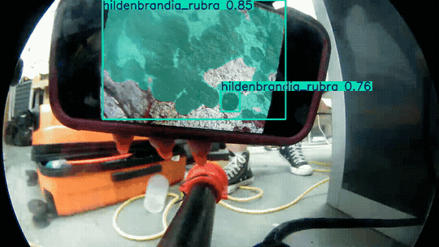
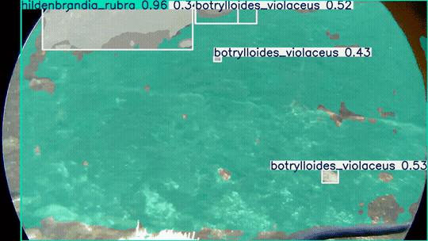
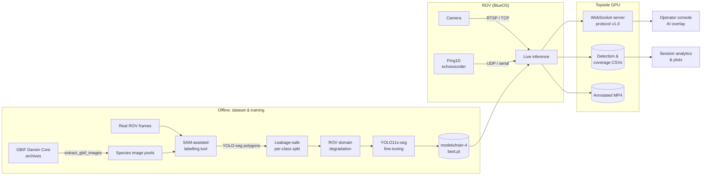
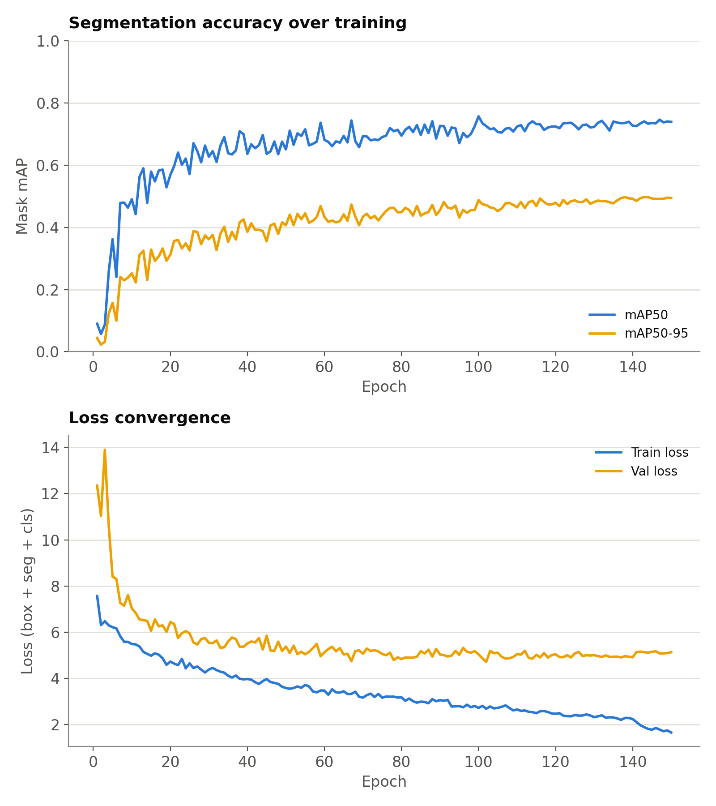
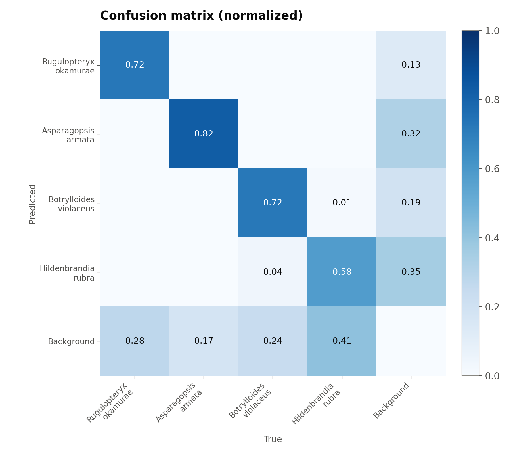

<div align="center">

# Biofouling ROV

**Real-time, species-level biofouling segmentation for underwater ROV inspection.**

A YOLO11 instance-segmentation pipeline that finds and identifies invasive fouling organisms in a live ROV camera feed. It runs topside next to BlueOS, streams detections to an operator console over WebSocket, and turns masks into percent-coverage and m² estimates using a Ping1D echosounder.

[](https://github.com/svillhauer/Biofouling_ROV/actions/workflows/ci.yml)





<sub>Live inference on the ROV's RTSP stream: per-instance masks, species labels and confidence scores, rendered in real time.</sub>

</div>

---

> [!NOTE]
> Designed and built during the **2026 Marine Robotics Summer School** (MIT Program · University of the Azores) in Horta, Faial, and field-tested on ROV footage from the Horta harbour.

## Why the Azores

**Horta is a transatlantic crossroads.** Faial is one of the main stopovers on North Atlantic sailing routes, and the Horta marina hosts vessels from all over the world. Every visiting hull can carry organisms from its last port, and island ecosystems like the Azores' are especially exposed to species that arrive this way.

**The hull pathway is barely monitored.** Ballast water is regulated by international agreement, but hull biofouling is managed mostly through voluntary guidance. Models of how species spread on ships have little field data to work with, because almost none is collected at the hull.

**The threat is already here.** The invasive brown alga *Rugulopteryx okamurae* has been reported on São Miguel and Faial, where mass strandings smother beaches and its decomposition harms benthic habitats, fisheries and tourism.

That shaped the design:

- **Species-level output, not "fouling yes/no."** An invasive alga and a native crust need different responses, so the model names the organism. *Rugulopteryx okamurae* is a first-class target.
- **Built for local water, without local training data.** No labelled Azorean dataset exists, so training starts from global GBIF photos, and a domain-adaptation step makes the model work in turbid harbour footage ([details](#closing-the-domain-gap)).
- **Every dive produces data.** Detections are logged with species, confidence, timestamps and measured coverage, producing the kind of hull-level field observations the spread models lack.

What it answers, live, during the dive:

| Question | How it's answered |
|---|---|
| **Is there fouling in view?** | Any class firing above threshold |
| **Which species?** | 4-class instance segmentation (not a generic "fouling" blob) |
| **How much?** | Union of instance masks → % of frame, and with echosounder range + camera FOV, m² of wall |
| **What did the pilot see?** | Masks overlaid on the operator console via WebSocket, plus timestamped CSV logs and annotated MP4 recordings |

## Highlights

- **Species-level instance segmentation.** Fine-tuned YOLO11s-seg on 4 organisms, with per-instance polygons rather than boxes, so coverage can be measured.
- **Closing the sim-to-sea domain gap.** The training photos are sharp, well-lit GBIF macro shots, while ROV footage is hazy, blue-green and blurry. A physically motivated degradation pass (detail loss, haze veil, desaturation, colour cast, sensor noise) plus a small set of hand-labelled real ROV frames made small, distant instances detectable. [Details below](#closing-the-domain-gap).
- **Leakage-safe evaluation.** Splits are grouped by GBIF occurrence record and stratified per class, so near-duplicate photos never straddle train/test and low-data species still get val/test coverage.
- **SAM-assisted labelling tool.** Point-and-click Segment Anything labelling with multi-instance and multi-class support, undo/back navigation and autosave. It was used to produce the dataset's masks.
- **Vehicle-integrated runtime.** Topside GPU inference against the BlueOS RTSP stream (TCP transport for tether reliability), a versioned WebSocket protocol for the operator console's AI overlay, and Ping1D range fusion for metric coverage.
- **Engineering hygiene.** Installable package, unit-tested core logic, ruff-linted, CI on every push.

## System architecture



## Target species

| ID | Species | Type | Why it matters |
|:-:|---|---|---|
| 0 | *Rugulopteryx okamurae* | Brown alga | Highly invasive; rapidly overgrows native benthos |
| 1 | *Asparagopsis armata* | Red alga | Invasive; forms dense turfs on hard substrate |
| 2 | *Botrylloides violaceus* | Colonial tunicate | Invasive fouler of hulls, pilings and aquaculture gear |
| 3 | *Hildenbrandia rubra* | Encrusting red alga | Thin crust that is easy to miss visually; tests fine-texture segmentation |

## Results

Model **`train-4`**: YOLO11s-seg, 640 px, 150 epochs, fine-tuned from COCO weights. Metrics are on the held-out validation split at the best checkpoint (epoch 138).

| Metric | Mask | Box |
|---|:-:|:-:|
| mAP@50 | **0.735** | 0.758 |
| mAP@50–95 | **0.497** | 0.544 |
| Precision | 0.785 | 0.790 |
| Recall | 0.705 | 0.712 |

<p align="center">
  
  &nbsp;
  
</p>

**Dataset:** 765 unique labelled images (1,074 instance masks, including 19 confirmed-background negatives), expanded with 457 ROV-degraded training copies.

| Split | Images | Notes |
|---|:-:|---|
| train | 1,043 | 586 originals + 457 ROV-degraded copies |
| val | 106 | untouched originals |
| test | 73 | untouched originals |

**Reading the confusion matrix:** cross-species confusion is close to zero, so when the model fires it nearly always names the right organism. The dominant error is *missed detection* (true organism predicted as background). That is most pronounced for *Hildenbrandia rubra*, a thin crust whose texture blends into bare rock. The fix is more real-footage labels rather than more architecture.

Full Ultralytics outputs (PR/F1 curves, label stats, val batch predictions) are in [`models/train-4/`](models/train-4).

## Closing the domain gap

Most of the engineering effort went here. GBIF photos are in-air or tidepool macro shots, while the deployment target is turbid harbor water seen through an ROV camera. An early model trained on GBIF photos alone fired on only **1 of 13** real ROV photos.

<details>
<summary><b>What worked, what didn't, and why</b></summary>

&nbsp;

1. **Global blur/noise augmentation: tried, rejected.** Heavy Albumentations degradation during training raised ROV detections from 1/13 to 10/13. Visual inspection showed the new "detections" were masking *smooth open water between rocks*. Degraded positives vastly outnumbered degraded negatives, so the model had learned **blur ⇒ organism**. The code is kept behind `--quality-degrade` (off by default) as a documented negative result.

2. **Offline, physically motivated degradation, with negatives degraded in lockstep.** [`degrade_domain_match.py`](scripts/data/degrade_domain_match.py) writes ROV-like copies of training images (train split only):
   - down/up-scale round-trip + Gaussian blur → loss of fine detail
   - saturation and contrast reduction → muted underwater light
   - a blurred, tinted *haze veil* blended over the image → colour cast that varies with scene content rather than a flat tint
   - Gaussian sensor/turbidity noise

   Confirmed-background images are degraded at the same rate, which keeps the positive:negative ratio intact and prevents the shortcut from step 1. Every transform is photometric or a same-size resize round-trip, so normalized polygon labels stay valid unchanged.

3. **Labelling real ROV frames directly.** The strongest fix. Degraded copies simulate blur at the *same* object scale, but real footage also has *small, distant* instances. Even a handful of hand-labelled ROV frames (five so far), folded into training with the same labelling tool, starts to cover that, and it's the main lever for future gains.

4. **Colour-invariance via HSV augmentation.** Hue/saturation/value jitter is raised above the YOLO defaults to cope with the strong blue-green cast.

</details>

## Quickstart

```bash
git clone https://github.com/svillhauer/Biofouling_ROV.git
cd Biofouling_ROV
pip install -e .            # core: ultralytics, opencv, numpy, ...
pip install -e ".[rov]"     # + Ping1D echosounder & WebSocket server for live ROV use
```

Scan a folder of images or a video with the bundled model:

```bash
python scripts/inference/scan_images.py --source path/to/rov_photos --save
```

```text
image                                     fouling?   species (max confidence)
--------------------------------------------------------------------------------
3.png                                     YES        hildenbrandia_rubra (0.97), botrylloides_violaceus (0.78)
3 images scanned, 3 had biofouling detected (100.0%)
```

## Live ROV deployment

Inference runs **topside** on a GPU laptop, not on the vehicle's companion computer, so it uses the full-size model with no export or quantization. The stream URL comes from BlueOS → *Video Manager*.

```bash
# 1. Operator-console overlay: WebSocket server + timestamped CSV log + annotated MP4
python scripts/inference/live_scan_ws.py --source rtsp://192.168.2.2:8554/video_udp_stream_0 --record

# 2. Metric coverage: fuse Ping1D range to convert % of frame into m² of wall
python scripts/inference/live_scan_coverage.py --source rtsp://192.168.2.2:8554/video \
    --ping-udp 192.168.2.2:9092 --hfov 80 --vfov 64

# 3. Minimal: local preview window + CSV log (use --source 0 to smoke-test on a webcam)
python scripts/inference/live_scan.py --source rtsp://192.168.2.2:8554/video
```

<details>
<summary><b>WebSocket protocol (v1.0)</b></summary>

&nbsp;

Served at `ws://<host>:8765/api/v1/detections/ws`. Clients receive a `hello` on connect, then one `detections` message per frame and a `heartbeat` (with measured FPS) once a second.

```json
{
  "protocol_version": "1.0",
  "type": "detections",
  "timestamp": 1752680131.42,
  "frame_id": 84,
  "image_width": 1920,
  "image_height": 1080,
  "detection_count": 1,
  "detections": [
    {
      "class_id": 3,
      "class_name": "hildenbrandia_rubra",
      "confidence": 0.8979,
      "bbox": { "format": "xyxy_pixels", "x1": 681.5, "y1": 0.0, "x2": 1917.4, "y2": 1076.7 },
      "polygon": { "points": [[0.355, 0.0], [0.998, 0.0], [0.998, 0.997]] }
    }
  ]
}
```

Polygon points are normalized `[0, 1]`. Inference runs on a worker thread and fans messages out to every connected console through the asyncio loop, so a slow client never stalls the model.

</details>

<details>
<summary><b>How coverage is computed</b></summary>

&nbsp;

Per frame, the union of all instance masks gives **% of frame covered**. That figure is scale-independent and needs no range. With the Ping1D distance *d* and the camera FOV, the visible wall patch is

$$A_{\text{frame}} = \left(2d\tan\tfrac{\text{HFOV}}{2}\right)\left(2d\tan\tfrac{\text{VFOV}}{2}\right)$$

so covered area = % coverage × *A*<sub>frame</sub>. Range and range-confidence are logged with every reading, so distant, less reliable frames can be filtered afterward. See [`biofouling/geometry.py`](src/biofouling/geometry.py) and its tests.

</details>

## Training pipeline

Reproduce the model end to end. Each step is a standalone CLI; run any of them with `--help` for all options.

| # | Step | Command |
|:-:|---|---|
| 1 | Download species images from a GBIF export | `python scripts/data/extract_gbif_images.py species.zip --out-subdir <name>` |
| 2 | Label with SAM (click → `SPACE` predict → `s` accept) | `python scripts/data/label_tool.py --source images/<name> --class-id <id>` |
| 3 | Leakage-safe per-class train/val/test split | `python scripts/data/split_dataset.py` |
| 4 | Add ROV-degraded training copies | `python scripts/data/degrade_domain_match.py` |
| 5 | Fine-tune YOLO11s-seg | `python scripts/train/train.py --weights yolo11s-seg.pt --epochs 150` |
| 6 | Presentation-quality training figures | `python scripts/train/plot_training_summary.py` |
| 7 | Plot a recorded field session | `python scripts/analysis/plot_session.py --log <session.csv>` |

Class definitions live in [`configs/data.yaml`](configs/data.yaml). Labels are versioned in `data/`, while the raw images are regenerated from GBIF (step 1) rather than committed.

## Repository layout

```text
Biofouling_ROV/
├── configs/
│   └── data.yaml                 # dataset paths & class map
├── src/biofouling/               # shared, unit-tested library code
│   ├── paths.py                  #   canonical repo paths
│   ├── species.py                #   display names & colour palette
│   ├── geometry.py               #   mask area, FOV footprint, m² coverage
│   ├── dataset.py                #   grouped, stratified splitting
│   ├── yolo_format.py            #   YOLO-seg label (de)serialization
│   ├── gbif.py                   #   robust parsing of ragged GBIF exports
│   └── plotting.py               #   shared figure style
├── scripts/
│   ├── data/                     # ingest → label → split → degrade
│   ├── train/                    # training & training figures
│   ├── inference/                # offline scan, live scan, coverage, WebSocket server
│   └── analysis/                 # field-session plots
├── models/train-4/               # released weights + full training artifacts
├── data/
│   ├── labels_yolo_seg/          # hand-labelled polygons (source of truth)
│   └── dataset/labels/           # resolved train/val/test split
├── results/field_sessions/       # live-scan detection logs & plots from ROV runs
├── docs/media/                   # README figures
└── tests/                        # pytest suite (runs in CI without a GPU)
```

## Development

```bash
pip install -e ".[dev]"
pytest          # unit tests for geometry, splitting, label I/O, GBIF parsing
ruff check .    # lint
```

CI runs lint and tests on Python 3.10 and 3.12 for every push. The tested core depends only on NumPy, so CI never has to install the CUDA/PyTorch stack.

## Limitations & roadmap

- **Coverage is per-frame, not per-survey.** Overlapping frames are not de-duplicated, so summing m² double-counts. Next step: register frames along the survey track (visual odometry + DVL / echosounder) into a mosaic and compute coverage once per wall patch.
- **Validation is mostly GBIF imagery.** A held-out set of *real ROV footage* is the right benchmark for deployment performance and is the top data priority.
- **Missed detections dominate the error budget**, especially for thin encrusting *Hildenbrandia*. More ROV-domain labels and higher-resolution tiling for small instances are the planned fixes.
- **On-vehicle inference.** Exporting to TensorRT/ONNX for a Jetson-class companion computer would remove the topside GPU and tether-bandwidth dependency.
